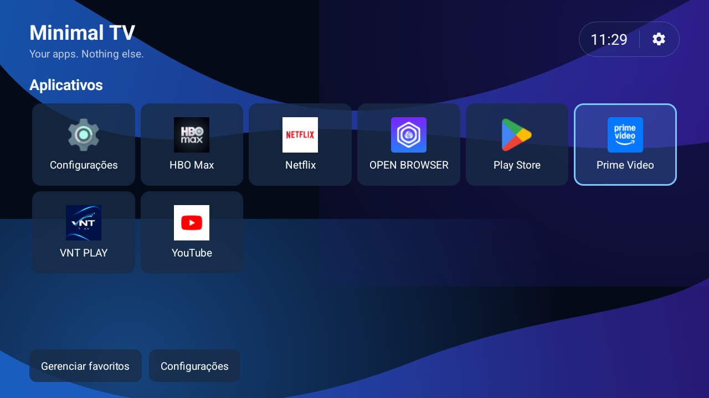

# Minimal TV

Um launcher Android TV feito para uma coisa: abrir seus aplicativos rapidamente, usando apenas o controle remoto.

Sem feeds, anúncios, recomendações ou serviços próprios rodando em segundo plano. A Home é compacta, offline e pensada para uma TV de sala.



> Captura real feita via ADB em uma TV Aiwa/KTC com resolução lógica de 1280×720.

## O que ele faz

- Descobre automaticamente aplicativos instalados com `LEANBACK_LAUNCHER` ou `LAUNCHER`.
- Mostra uma grade de seis colunas em 1280×720.
- Abre aplicativos com OK, incluindo Netflix, HBO Max, Prime Video e Play Store.
- Ordena favoritos antes dos demais e registra a quantidade de aberturas.
- Mantém favoritos e histórico entre reinicializações.
- Usa pressão longa em OK para adicionar ou remover favoritos.
- Atualiza a lista quando aplicativos são instalados, atualizados ou removidos.
- Restaura o foco do controle remoto depois de retornar de um app externo.
- Inclui acesso às configurações do Android TV.
- Não exige internet, não altera firmware e não precisa ser o Home padrão.

## Direção visual

A interface usa uma linguagem azul‑roxa com fundo desenhado nativamente, cards azul‑marinho translúcidos e foco azul luminoso.

| Elemento | Direção |
| --- | --- |
| Fundo | `#050A19` com ondas azul/roxo |
| Cards | Azul‑marinho translúcido |
| Foco | `#79C8FF` |
| Texto | `#F4F7FF` |
| Grade | 6 colunas em 1280×720 |
| Ícones | 48dp, carregados do pacote real |

## Hardware validado

O projeto foi exercitado em uma TV Aiwa/KTC com:

- Android TV 14 / API 34;
- resolução lógica 1280×720 e física 1920×1080;
- densidade 213 dpi;
- ABI `armeabi-v7a, armeabi`;
- conexão ADB sem fio;
- aproximadamente 913 MiB de RAM reportados pelo sistema.

O endereço ADB é dinâmico. O serial usado durante a validação foi `192.168.1.9:36661`.

## Desenvolvimento

Requisitos:

- JDK 17;
- Android SDK Platform 35;
- Build Tools 35.0.0;
- Platform Tools;
- Gradle Wrapper incluído no projeto.

No macOS Apple Silicon, o ambiente usado foi:

```bash
export JAVA_HOME=/opt/homebrew/opt/openjdk@17/libexec/openjdk.jdk/Contents/Home
export ANDROID_HOME=/opt/homebrew/share/android-commandlinetools
```

## Build e testes

```bash
./gradlew :app:testDebugUnitTest
./gradlew :app:assembleDebug
./gradlew :app:connectedDebugAndroidTest
```

O APK gerado fica em:

```text
app/build/outputs/apk/debug/app-debug.apk
```

## Instalar na TV

Descubra o serial atual:

```bash
adb devices -l
```

Depois compile e instale:

```bash
./gradlew clean :app:assembleDebug

adb -s <serial> install -r \
  app/build/outputs/apk/debug/app-debug.apk

adb -s <serial> shell am force-stop com.minimaltv.launcher
adb -s <serial> shell am start \
  -n com.minimaltv.launcher/.MainActivity
```

Essa instalação abre o Minimal TV como um app comum e não troca o Home padrão.

## Usar como Home

Alguns firmwares de Android TV escondem a tela de escolha de launcher. Quando o comando é suportado, use:

```bash
adb -s <serial> shell cmd package set-home-activity \
  --user 0 com.minimaltv.launcher/.MainActivity
```

O projeto não remove nem desativa automaticamente o launcher original. Em TVs que forçam o launcher de fábrica, o botão Home pode continuar abrindo o launcher da Google mesmo depois da preferência ser gravada.

## Recuperação segura

Mantenha o launcher da Google instalado. Para reativá-lo:

```bash
adb -s <serial> shell pm enable \
  --user 0 com.google.android.tvlauncher

adb -s <serial> shell cmd package set-home-activity \
  --user 0 com.google.android.tvlauncher/.MainActivity
```

Não use `pm uninstall --user 0` nem `pm disable-user` em componentes MediaTek da TV sem um procedimento de recuperação confirmado.

## Pacotes específicos da TV

Na TV validada, os seguintes componentes são mantidos instalados e apenas ocultados da grade do Minimal TV:

```text
com.mediatek.wwtv.tvcenter
com.mediatek.wwtv.mediaplayer
com.mediatek.androidbox
```

Play Filmes, Play Games e YouTube Music foram removidos somente para o usuário Android 0. Eles podem ser restaurados com:

```bash
adb -s <serial> shell cmd package install-existing --user 0 com.google.android.videos
adb -s <serial> shell cmd package install-existing --user 0 com.google.android.play.games
adb -s <serial> shell cmd package install-existing --user 0 com.google.android.youtube.tvmusic
```

## Arquitetura

O projeto possui um único módulo Android e uma Activity principal:

```text
app/
├── data/       descoberta, launch, persistência, ordenação e visibilidade
├── model/      modelo TvApp
├── ui/         adapter, foco, ícones e fundo visual
├── res/layout/ telas da Home e cards
└── src/test/   regras puras e testes de comportamento
```

As consultas ao `PackageManager` acontecem fora da thread principal. Favoritos e contadores usam `SharedPreferences`. A Activity observa mudanças de pacotes sem polling contínuo.

## Diagnóstico

```bash
adb -s <serial> shell dumpsys meminfo -s com.minimaltv.launcher
adb -s <serial> shell top -b -n 1 -m 15
adb -s <serial> logcat -d -t 500 | grep -E 'com.minimaltv.launcher|FATAL EXCEPTION|ANR'
```

PSS, RSS e CPU devem ser comparados sob as mesmas condições. As metas de desempenho documentadas são metas de engenharia, não garantias.

## Documentação adicional

- [Minimal Voice para macOS](macos/MinimalVoice/README.md)
- [Especificação do MVP](SPEC.md)
- [Produto e contexto](PRODUCT.md)
- [Direção visual](DESIGN.md)
- [Plano de testes](TEST_PLAN.md)
- [Desempenho](PERFORMANCE.md)
- [Changelog](CHANGELOG.md)
